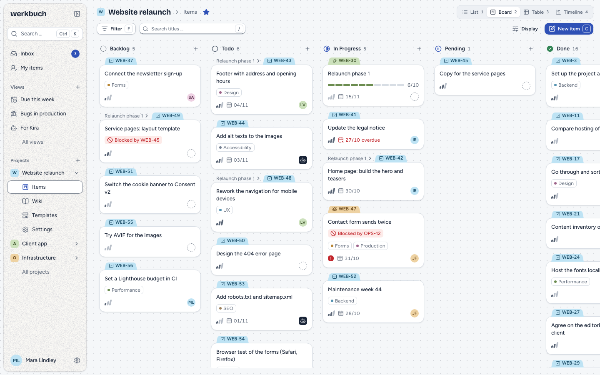
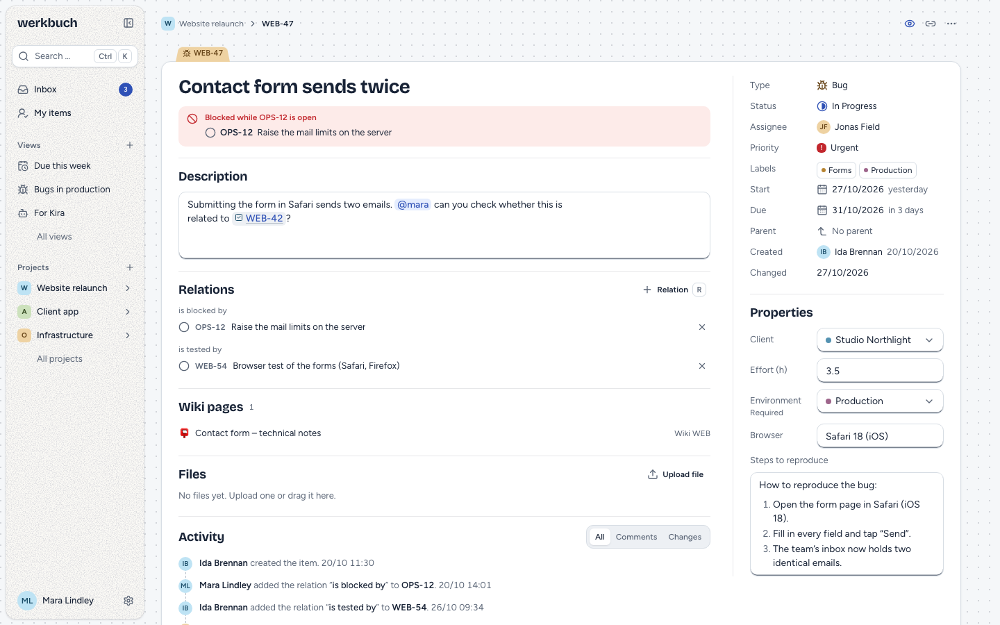
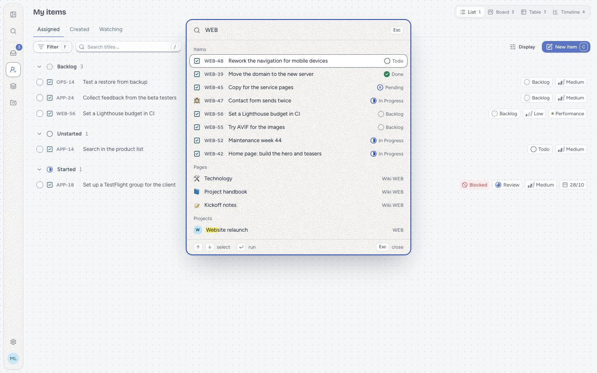

# werkbuch

Project management you host yourself: work items with your own types, fields and workflows, a wiki per project, team-wide views across projects, recurring work from templates and switchable automations. Made for the keyboard, and open to scripts and AI agents through a REST API, an MCP server and webhooks. The docs are at https://werkbuch.dev.

> **Status:** the build is done. Before v0.1.0 everything gets one more round of testing by hand, so there is no release yet – until then you build the image yourself (see below). The concept is in [`docs/superpowers/specs/2026-10-28-werkbuch-design.md`](docs/superpowers/specs/2026-10-28-werkbuch-design.md) (German), a clickable prototype with demo data in [`prototypes/clickdummy/`](prototypes/clickdummy/) (German UI).

## Screenshots







## Self-hosting

werkbuch runs as a Docker Compose stack: the image `baeroe/werkbuch` (web service, Reverb for live updates, three queue workers, the scheduler) with MariaDB 11.4 and Meilisearch 1.56, everything behind one port (`7740`). You need Docker with Compose v2.20 or newer, 2 vCPU and 2 GB of RAM (4 GB recommended).

```bash
curl -fsSLO https://raw.githubusercontent.com/baeroe/werkbuch/main/docker-compose.yml
curl -fsSL -o .env https://raw.githubusercontent.com/baeroe/werkbuch/main/.env.docker.example
# edit .env: APP_URL, ADMIN_EMAIL, ADMIN_PASSWORD, DB_PASSWORD, DB_ROOT_PASSWORD, MEILISEARCH_KEY
docker compose up -d
```

Put a reverse proxy with HTTPS in front, set `APP_URL` to its address and sign in with `ADMIN_EMAIL` and `ADMIN_PASSWORD`. For Dockge or Portainer there is [`docker-compose.standalone.yml`](docker-compose.standalone.yml), one file without `.env`.

Until the first release, the image and the files on `main` are not published yet: build the image from a clone with `docker buildx build --load -t werkbuch:local .` and set `WERKBUCH_IMAGE=werkbuch:local` in `.env`.

- [Setup](https://werkbuch.dev/en/setup) and [Reverse proxy](https://werkbuch.dev/en/reverse-proxy)
- [Operations](https://werkbuch.dev/en/operations), [Upgrading](https://werkbuch.dev/en/upgrading) and [Backup](https://werkbuch.dev/en/backup)
- [REST API](https://werkbuch.dev/en/api), [MCP](https://werkbuch.dev/en/mcp) and [Webhooks](https://werkbuch.dev/en/webhooks)

## Development

Local development runs in [DDEV](https://ddev.com) (PHP 8.4, MariaDB 11.4, Meilisearch, Node 24 with pnpm); the guide is the [development page](https://werkbuch.dev/en/development). The docs live in [`docs/`](docs) (VitePress, English and German) and are published at https://werkbuch.dev; locally: `ddev exec pnpm --dir docs dev`.

## Stack

Laravel, Inertia and React with a custom UI, MariaDB, Meilisearch, Laravel Reverb. Shipped as a Docker image with a Compose stack.

## License

[MIT](LICENSE)
