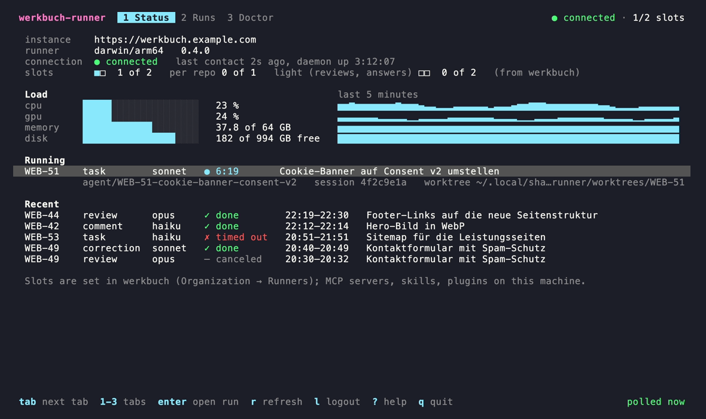
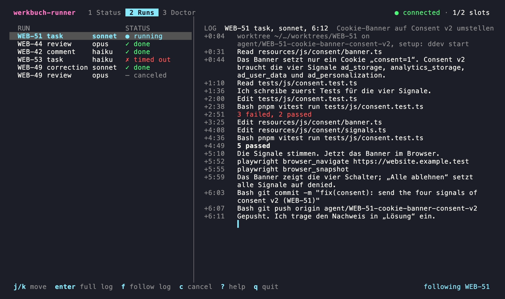
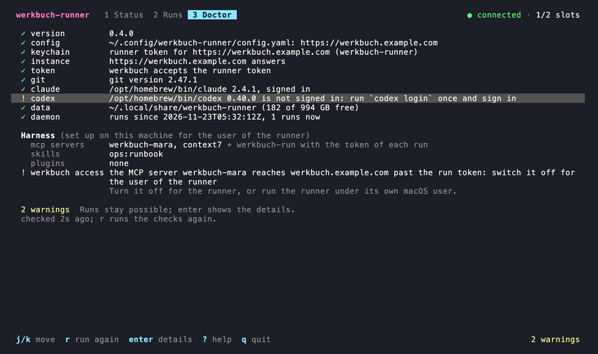

# werkbuch-runner

Runs agents of a [werkbuch](https://werkbuch.dev) instance on your own machine. The runner polls the instance over
HTTPS (no open port), runs Claude Code or Codex headless in a git worktree per strand and reports the log, heartbeats
and the result back. Name, places and the setup commands of projects are set in werkbuch; the runner keeps only the
instance URL (`~/.config/werkbuch-runner/config.yaml`) and its token (in the keychain).

## Install

Settings → Runners → Connect runner in werkbuch shows the command with a one-time code:

```sh
curl -fsSL https://werkbuch.example.com/runner/install.sh | sh -s -- --code ABCD-EFGH
```

The script downloads the runner of that instance (`/runner/download/<os>/<arch>`), checks its SHA-256 sum, puts it into
`~/.local/bin` (`--prefix <dir>` for another place), pairs it and makes it a service of this user: a launch agent
`dev.werkbuch.runner` on macOS, a systemd user unit `werkbuch-runner.service` on Linux. `--no-service` writes the plist
or unit without loading it; `--name <name>` names the runner. Never as root, never with sudo. Running it again with a
new code pairs the runner again and replaces the service.

## Commands

```sh
werkbuch-runner           # the TUI: status, runs with their live logs, doctor (in a terminal)
werkbuch-runner login https://werkbuch.example.com --code ABCD-EFGH   # pair (the code comes from Settings → Runners)
werkbuch-runner daemon    # poll and run (launchd/systemd units come with the installer)
werkbuch-runner status    # what the daemon does now
werkbuch-runner doctor    # CLIs, keychain, instance, token, git, equipment
werkbuch-runner update    # update to the version the instance expects
werkbuch-runner service install [--no-start]   # the launch agent or systemd user unit (the installer calls it)
werkbuch-runner service uninstall              # stop and remove it
werkbuch-runner logout    # forget the instance and its token
werkbuch-runner version
```

The daemon listens on `~/.local/state/werkbuch-runner/runner.sock` (`GET /status`, `GET /runs`,
`GET /runs/{id}/events`, `POST /runs/{id}/cancel`, `GET /load`, `GET /doctor`, `POST /update`) for the TUI; `GET /status`
names the daemon's clock (`now`), from which the TUI counts the times of runs.

## TUI

`werkbuch-runner` without a command opens the TUI. It reads the daemon over its socket every two seconds; nothing is set
up in it except logging out (`l`): slots and setup commands live in werkbuch (Organization → Runners), MCP servers,
skills and plugins are set up on the machine for the user of the runner.



- **Status** (`1`): instance, version, connection, the slots werkbuch sets, CPU, GPU, memory and disk with the last five
  minutes, the running runs with branch, session and worktree, the recent ones. `enter` opens the chosen run in Runs.
- **Runs** (`2`): the runs on the left, the log of the chosen one on the right, live while the agent works; `enter` shows
  the log in full (`j`/`k`, `g`/`G`), `f` follows it, `c` cancels the run after a question (werkbuch hears `canceled`).
- **Doctor** (`3`): the checks of `werkbuch-runner doctor`, made by the daemon with its own environment (its `PATH` and
  keychain under launchd), the version werkbuch expects, the equipment of the machine and a warning when an MCP server
  reaches werkbuch past the run token. Without a daemon the TUI checks itself and says so. `r` checks again, `enter`
  shows a check in full.

`tab`/`⇧tab` or `1`–`3` switch tabs, `?` shows the keys, `q` quits.





## Development

```sh
make test                      # gofmt, go vet, go test -race
make build VERSION=0.3.2       # bin/werkbuch-runner, static, without cgo
ddev runner-build              # the four binaries for the instance in DDEV (runner/dist, like the image)
```

Tests run against a fake werkbuch (`internal/fakewerkbuch`) and a fake Claude Code (`testdata/claude`, a shell script
that writes stream-json); the TUI against a fake daemon. `bash docs/screenshots.sh` renders the screenshots with VHS
(`brew install vhs`) from the tapes in `docs/tapes/` against the demo daemon `docs/demo` (fictitious data on a fixed clock,
instance `werkbuch.example.com`), in a sandbox that never touches a real daemon, config or keychain. The design is in `docs/superpowers/specs/2026-11-23-runner-design.md`.
